# **<span style="font-size: 30px; vertical-align: middle;">Hello, Let's Ai Talk !</span>**

<p align="left">
  
  
  
  
  
</p>


## 📔 Introduction

**Ai Talk** is a dual-scenario AI dialogue client for both **individuals** and **enterprises**. Built on Electron, it achieves a unified cross-platform experience, aggregating mainstream large models and private APIs for out-of-the-box use. It features built-in **DLP data leakage prevention** and **operation audit trail**, balancing AI efficiency with data security and compliance. Supports macOS, Windows, and Linux platforms; install and run immediately.

</br>

**✨ Key Features**

<table width="100%" border="0" cellpadding="14" cellspacing="8">
  <tr>
    <td align="center" valign="middle" style="border: 1px solid #e1e4e8; border-radius: 8px; background: #ffffff; box-shadow: 0 1px 3px rgba(0,0,0,0.06);">
      
      <div style="font-weight: 600; margin-top: 6px;">DLP leak prevention</div>
    </td>
    <td align="center" valign="middle" style="border: 1px solid #e1e4e8; border-radius: 8px; background: #ffffff; box-shadow: 0 1px 3px rgba(0,0,0,0.06);">
      
      <div style="font-weight: 600; margin-top: 6px;">Operational audit</div>
    </td>
    <td align="center" valign="middle" style="border: 1px solid #e1e4e8; border-radius: 8px; background: #ffffff; box-shadow: 0 1px 3px rgba(0,0,0,0.06);">
      
      <div style="font-weight: 600; margin-top: 6px;">Session enhancement</div>
    </td>
    <td align="center" valign="middle" style="border: 1px solid #e1e4e8; border-radius: 8px; background: #ffffff; box-shadow: 0 1px 3px rgba(0,0,0,0.06);">
      
      <div style="font-weight: 600; margin-top: 6px;">Skill Expansion</div>
    </td>
    <td align="center" valign="middle" style="border: 1px solid #e1e4e8; border-radius: 8px; background: #ffffff; box-shadow: 0 1px 3px rgba(0,0,0,0.06);">
      
      <div style="font-weight: 600; margin-top: 6px;">Multi-model aggregation</div>
    </td>
  </tr>
</table>

<br/>

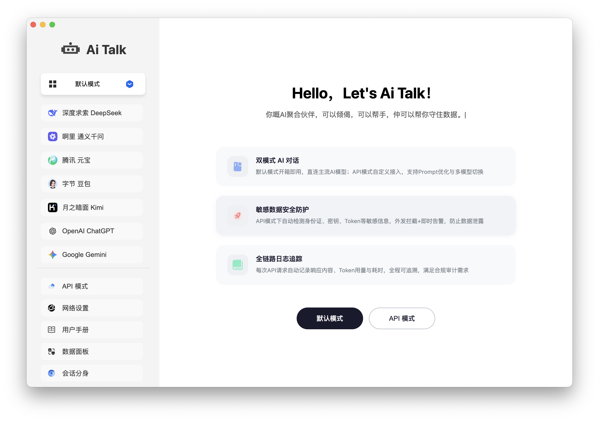

## 📟 Feature Introduction

### Default Mode

Directly connects to the official large model entry service, ready to use out of the box. Reference links in the model output can be opened and viewed directly within the application. Default mode supports session cloning.

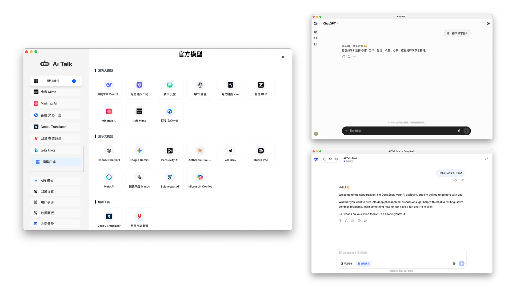

### API Mode

Suitable for internal enterprise model API access. The application has a built-in session memory system (it does not remember data across sessions, but can reference content across sessions) and context compression.

✨ **"Sensitive Data Monitoring for External Sending"** detection is enabled by default. It will automatically issue an alert before sending sensitive data to the AI large model; if the user still chooses to send it, the sensitive content will be anonymized before sending. The detection rules support matching sensitive data types within the enterprise using custom regular expressions, flexibly adapting to the compliance needs of different enterprises.

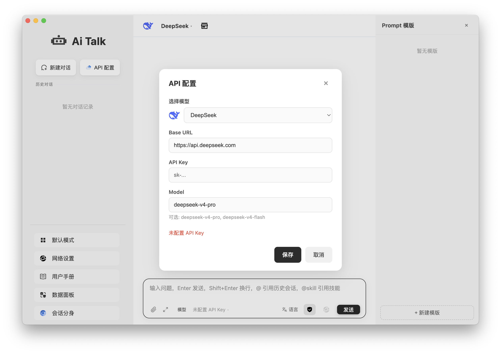

#### Sensitive Data Outgoing Transmission Detection (DLP)

In API mode, the system automatically scans content before data is sent out, matching it against sensitive information patterns (such as ID card numbers, mobile phone numbers, bank card numbers, enterprise-defined rules, etc.). When a detection is successful:

- The detected sensitive content is displayed in full plaintext, allowing users to clearly understand the data about to be sent;

- Users can choose to **block transmission** or **continue transmission**;

- If the user chooses to continue transmission, the system will anonymize the sensitive data before sending it out.

Detection rules are managed through `config/dlp-rules.json`, supporting custom regular expressions and capable of matching any sensitive data type defined internally by the enterprise.

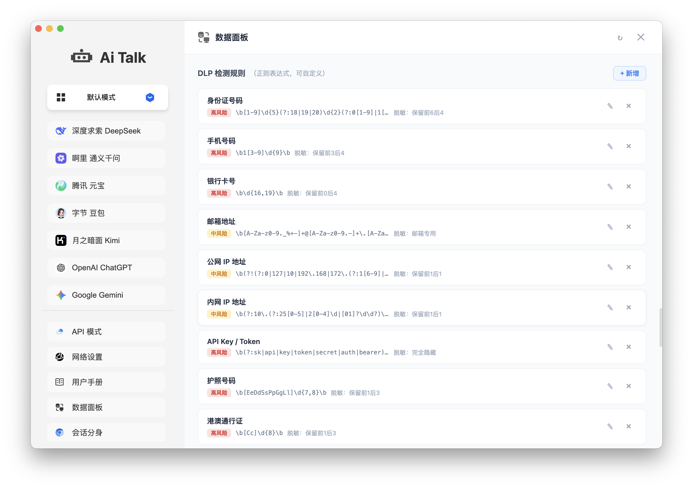

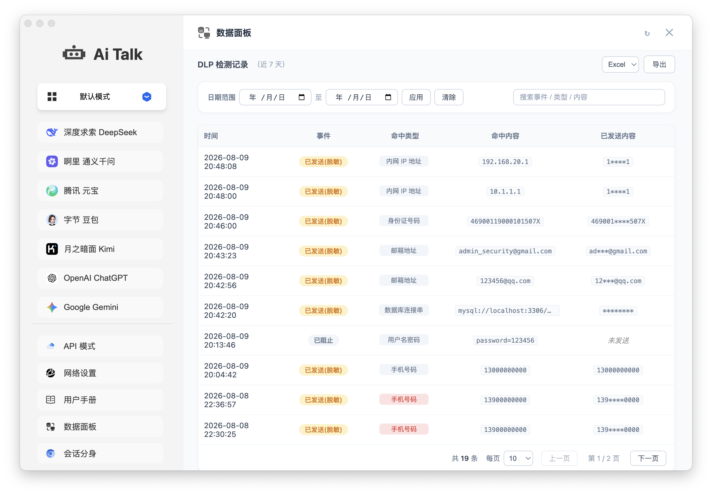

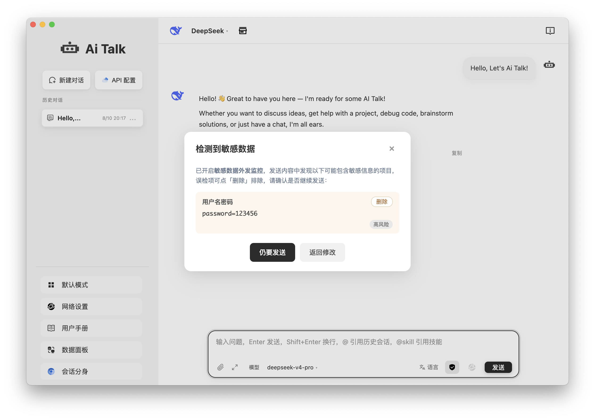

#### Operation Audit Log

The system records complete operation logs, meeting compliance audit requirements:

- Program sending and access behavior records

- DLP detection records (hit content, anonymized content, user decisions)

- Token consumption statistics

- Request URL, model name, response status, time consumption, etc.

Logs are stored in plaintext and can be viewed and exported from the application's "**Data Panel**".

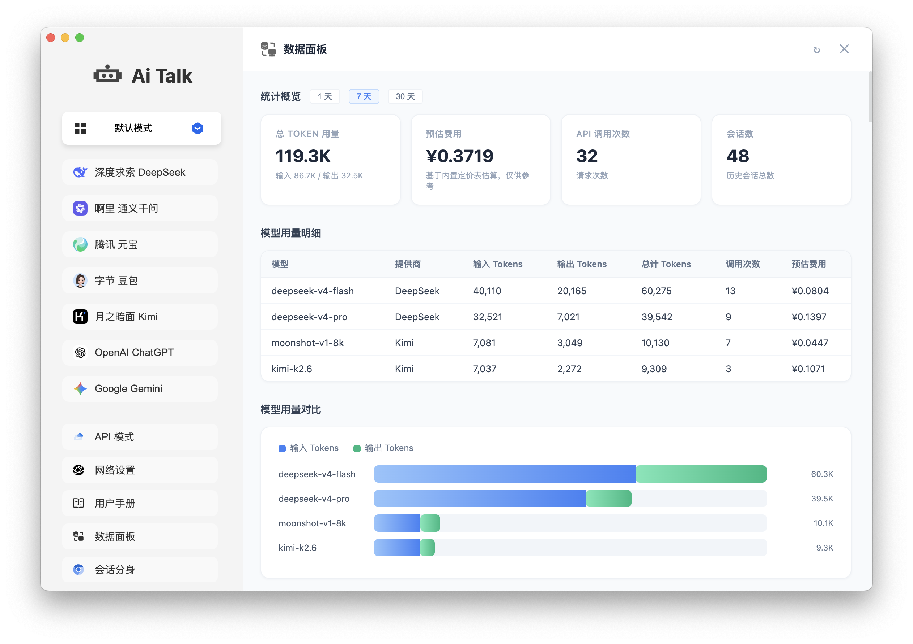

#### Skill Shop

Supports importing custom skills through the Skill Shop. Skills are written in a standard format and can declare the allowed directory ranges.

- Executes within a secure sandbox, allowing only read access to authorized directories.

- Read-only, no write access; unauthorized directories are strictly prohibited from being read.

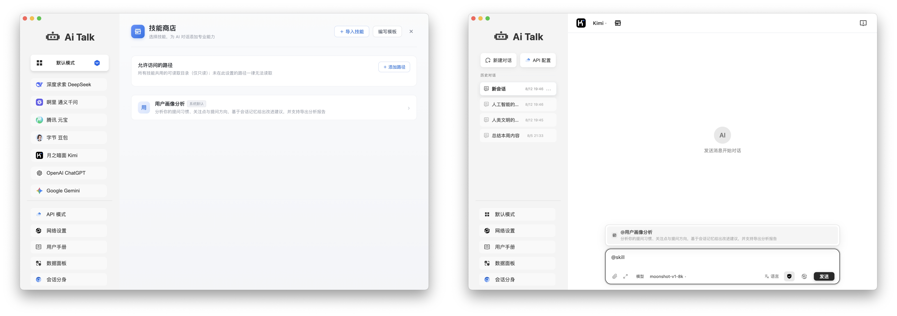

#### Session Memory and Context Management

The API mode includes a built-in session memory system that supports referencing historical content across sessions (by default, it does not support cross-session memory) and features a context compression mechanism that automatically simplifies content when it exceeds the window size, maintaining consistency and reducing token consumption.

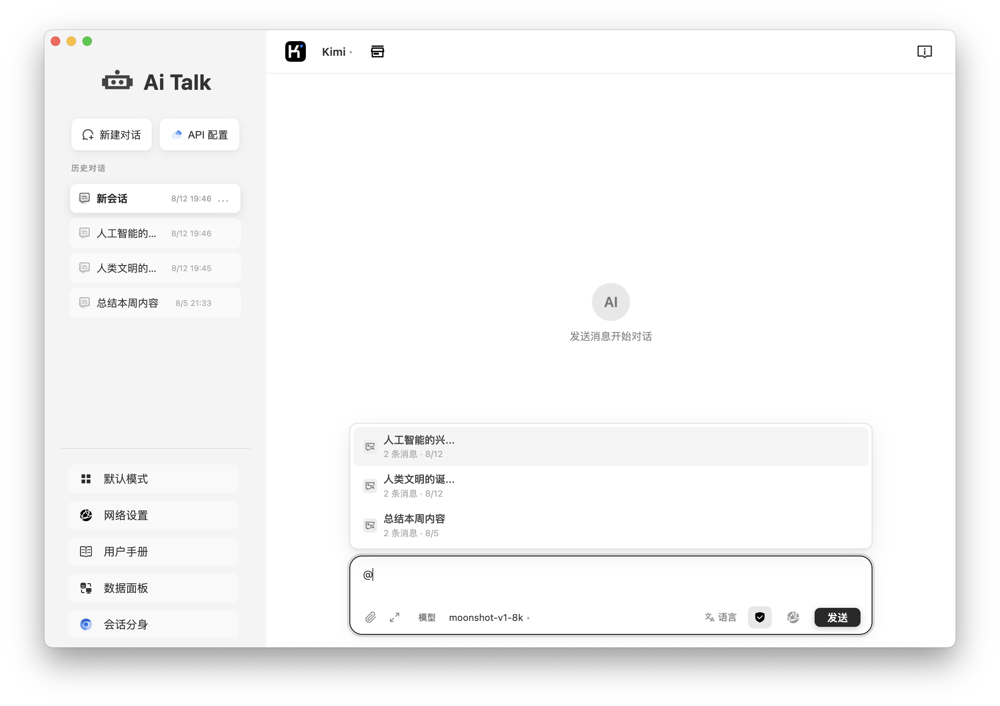


#### Prompt Template Library

Built-in Prompt template library, supporting custom templates and categorized management to reduce repetitive input of frequently used prompts; also provides Prompt optimization capabilities to help users express their needs more clearly and accurately.

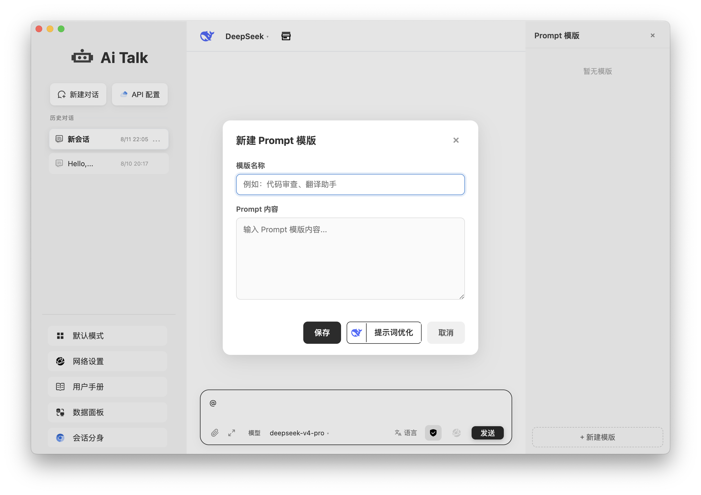

#### Online Search

Some models support online search. After selecting a model that can be accessed online, click the "Online Search" button to start the online search.

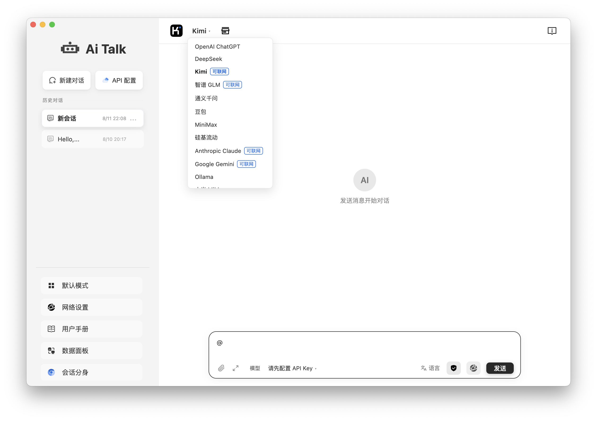

## 🔐 Data and Security

- Program data is **stored locally** (session logs, configuration files, logs)

- Cross-device data migration is possible via directory copying

- Sensitive data detection is performed locally; DLP judgment and de-identification do not rely on external services.

- Skill execution is read-only throughout and is subject to the "allowed access paths" sandbox constraint.

| platform  | Path                                     |
| --------- | ---------------------------------------- |
| macOS DMG | `~/Library/Application Support/Ai Talk/` |
| Windows   | `%APPDATA%/Ai Talk/`                     |
| Linux     | `~/.config/Ai Talk/`                     |


## ⌨️ Start from source code

- Install Node.js

```
https://nodejs.org/zh-cn/download
```

- Download project source code

```
git clone https://github.com/Funsiooo/Ai-Talk.git
```

- Install Electron

```
cd Ai-Talk
npm install electron --save-dev -d --registry=https://registry.npmmirror.com
```

- Execute in the Ai Talk directory

```
npm start
```


## 📦 Packing Guide

- Install Node.js

```
https://nodejs.org/zh-cn/download
```

- Download project source code

```
git clone https://github.com/Funsiooo/Ai-Talk.git
```

- Install electron

```
cd Ai-Talk
npm install electron --save-dev -d --registry=https://registry.npmmirror.com
```

- Install electron-forge/cli

```
npm install --save-dev @electron-forge/cli -d --registry=https://registry.npmmirror.com
```

- macOS requires maker-dmg to be installed

```
npm install --save-dev @electron-forge/maker-dmg -d --registry=https://registry.npmmirror.com
```

- - Windows: MSI packaging requires WiX Toolset v3 to be installed

```
下载地址：https://github.com/wixtoolset/wix3/releases/tag/wix3112rtm
建议使用 wix311-binaries.zip，解压后将 bin 目录路径添加到系统环境变量 PATH 中
```

- - Linux: deb/rpm packaging

```
npm install --save-dev @electron-forge/maker-deb @electron-forge/maker-rpm -d --registry=https://registry.npmmirror.com
```

- - Execute the packaging (output file located in `out/`) (Table of Contents)

```
npm run build
```

> **Note:** Errors encountered during the packaging process can be ignored. If packaging fails, try running `npm cache clean --force` to clear the cache and try again.


## 🛎️ FQA

macOS users may encounter the following error after downloading and installing the app. This is because the new macOS system disables the installation of unverified third-party applications by default, and the "Anywhere" option is hidden. Users need to execute the following command in Terminal to re-enable this option, and then reopen the application to use it normally.

```
sudo spctl --master-disable
```

[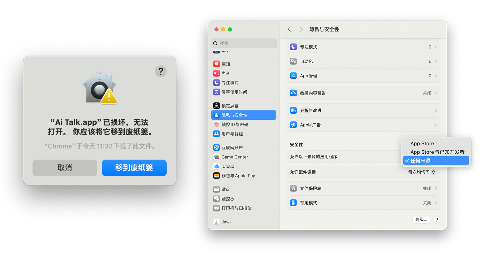](https://github.com/Funsiooo/Ai-Talk/blob/main/assets/fqa.png)

